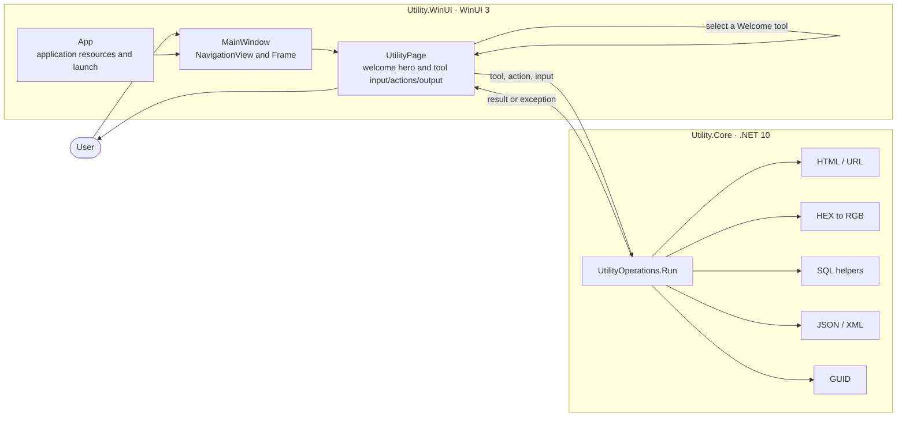
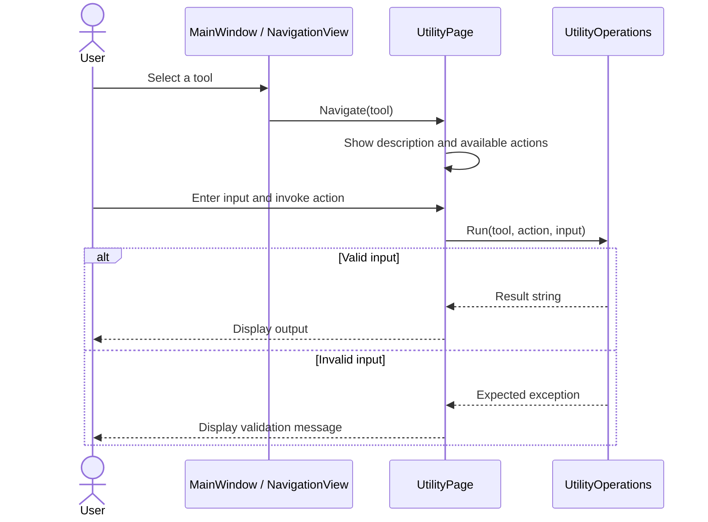
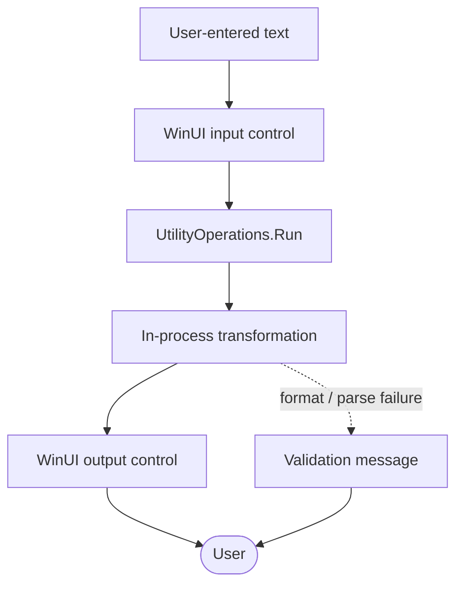
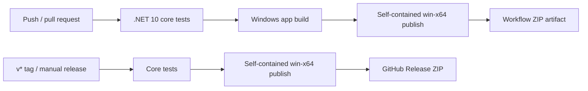

# Architecture

Utility-WinUI is a Windows desktop application. Its UI is a thin WinUI 3 shell over a cross-platform .NET core library. Utility operations are synchronous, local transformations; there is no network or persistence layer.

## Components

### WinUI application (`src/`)

- `App.xaml` merges `XamlControlsResources`; `App.xaml.cs` creates and activates the main window on launch.
- `MainWindow.xaml` defines the navigation menu and content frame. `MainWindow.xaml.cs` routes the selected tool to the utility page.
- `UtilityPage.xaml` provides the interactive Welcome hero and reusable input/action/output layout. `WelcomeHero` animates the available tools with Windows Composition, supports direct tool navigation and replay, and honors the Windows animation-effects setting. The page code-behind chooses tool descriptions and actions, calls the core library, and displays expected validation errors.
- `Utility.WinUI.csproj` targets `net10.0-windows10.0.19041.0`, uses Windows App SDK 1.6, and references the core project.

### Core library (`src/Utility.Core/`)

`UtilityOperations.Run(tool, action, input)` is the dispatch boundary. It delegates to focused transformations implemented in `UtilityOperations.cs` and returns a string result. Invalid input can raise format/parsing exceptions; unavailable tool/action pairs raise `InvalidOperationException`. The core project targets `net10.0` and has no additional package references.

### Tests (`tests/`)

`Utility.Core.Tests` is an xUnit test project targeting `net10.0`. It references the core project and covers the individual operations, including malformed inputs and preservation of user data in SQL/XML formatting.

## Navigation and operation flow

## Data and trust boundaries

Input remains in process memory for the duration of the operation and is not uploaded or stored by the app. The SQL `IN` builder escapes apostrophes in values, but its output is a text convenience and is not a substitute for parameterized SQL in application code. The SQL formatter handles common tokens and clauses; it is not a full SQL parser.

## Build and delivery

The build/test workflow runs on Windows and publishes a downloadable workflow artifact. The release workflow reruns the tests and attaches the ZIP to a GitHub Release. Workflow definitions are in `.github/workflows/`.

## Repository map

| Path | Responsibility |
| --- | --- |
| `src/` | WinUI application and shared core project |
| `src/WelcomeHero.*` | Composition-based Welcome scene and tool shortcuts |
| `tests/Utility.Core.Tests/` | Cross-platform tests for core operations |
| `docs/USER_GUIDE.md` | User, tool, developer, and release instructions |
| `assets/` | Original logo, icon, and social preview artwork |
| `.github/workflows/` | Windows build/test and release automation |
