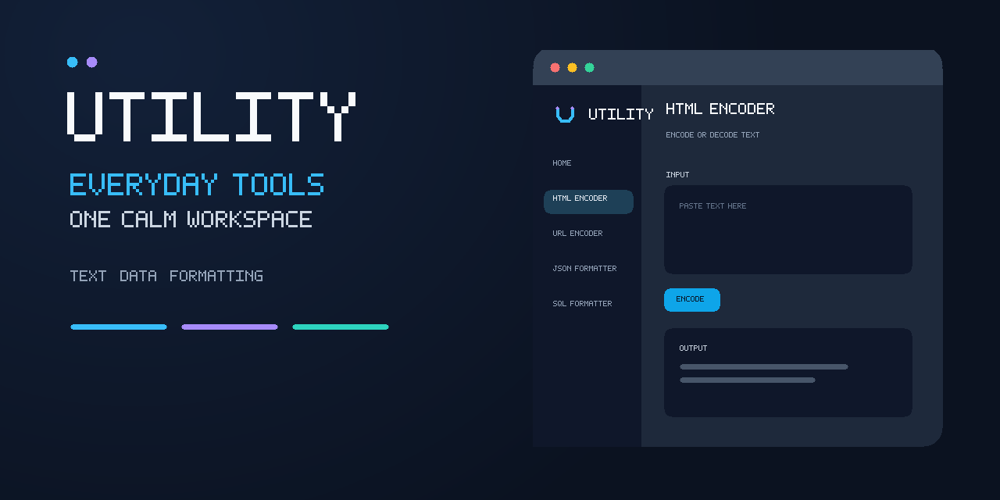

# Utility-WinUI

Utility is a Windows desktop collection of practical text, data, and formatting tools, built with WinUI 3. Work with input locally in a simple, keyboard-friendly workspace; the app does not send input to a service.



## Features

- Encode and decode HTML entities and URL components
- Convert 3- or 6-digit HEX colors to RGB
- Build escaped SQL `IN` clauses from comma- or line-separated values
- Generate GUIDs
- Format or minify JSON and XML
- Format common SQL clauses

See the [user guide](docs/USER_GUIDE.md) for tool behavior and examples, and the [architecture guide](ARCHITECTURE.md) for the app structure and data flow.

## Build and run

On Windows, install Visual Studio 2026 (18.0 or newer) with the **.NET desktop development** workload, the .NET 10 SDK, and the Windows 10/11 SDK. Open `src/Utility.WinUI.csproj`, restore NuGet packages, and run the project. The project targets .NET 10 and uses the Windows App SDK 1.6.

Run the cross-platform core tests from the repository root:

```sh
dotnet test tests/Utility.Core.Tests/Utility.Core.Tests.csproj --configuration Release
```

## CI and releases

The **Build and test** GitHub Actions workflow runs core tests, builds the Windows app, and uploads a self-contained `win-x64` ZIP artifact for pushes to `main` or `master`, pull requests, and manual dispatch. The **Release** workflow runs on `v*` tags or can be started manually with an existing tag; it attaches the self-contained ZIP to a GitHub Release. See [GitHub Actions](.github/workflows/) and [release instructions](docs/USER_GUIDE.md#releasing).

## Project documentation

- [User guide](docs/USER_GUIDE.md)
- [Architecture](ARCHITECTURE.md)
- [Changelog](CHANGELOG.md)
- [Brand assets](assets/)

## License

See [LICENSE](LICENSE).
